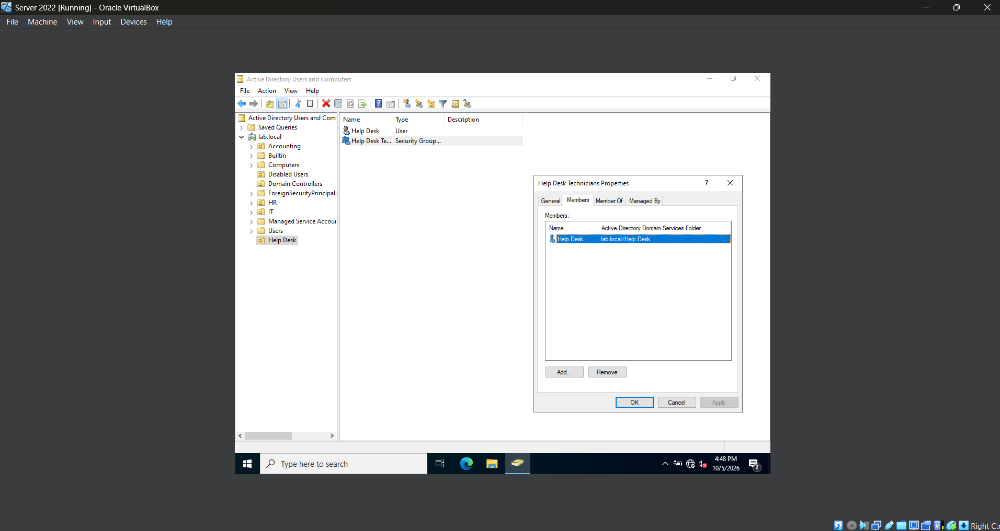

# **Lab 13 - Help Desk Administration with RSAT & Active Directory**

## **Objective**

## **Environment**

## **Skills Demonstrated**

## **Steps**

### *Step 1 - Create the Help Desk Group and Technician Account*



In the Windows Server 2022 VM, I open **Active Directory Users and Computers (ADUC)** and create a new Organizational Unit named **Help Desk** under the `lab.local` domain.

Inside the Help Desk OU, I create a new user account named **Help Desk** with the username `helpdesk01`. This account will represent a Tier 1 Help Desk technician and will later be used to remotely perform limited Active Directory administration from the Windows 11 workstation.

I also create a new Global Security group named **Help Desk Technicians** and add the Help Desk account as a member.

The Help Desk account remains a standard domain user and is not added to privileged groups such as **Domain Admins**. At this point, membership in the Help Desk Technicians group also does not provide any additional administrative permissions.

Instead of assigning permissions directly to the `helpdesk01` account, I will later delegate the required Active Directory permissions to the **Help Desk Technicians** security group. This allows additional Help Desk technicians to receive the same permissions simply by being added to the group.

This creates the initial structure for testing least-privilege Help Desk administration. The technician has a domain account and belongs to the appropriate role-based security group, but has not yet been granted permission to perform administrative tasks in Active Directory.

### *Step 2 - Deploy the Help Desk Workstation and Install RSAT*

To create a dedicated workstation for Help Desk administration, I set up another **Windows 11 Pro VM** in Oracle VirtualBox named `HelpDesk-01`.

Unlike my original Windows 11 workstation from Lab 02, I no longer need to manually configure the client's IP address or DNS settings. Since I previously configured a DHCP server in Lab 09, the new workstation automatically receives its network configuration from `CA-DC-01` when connected to the correct Host-only network. I verify the network configuration, join `HelpDesk-01` to the `lab.local` domain, and restart the workstation.

During the initial Windows 11 setup, I create a local administrator account named `temp`. I use this account to prepare the workstation and install administrative tools before signing into the domain with the dedicated Help Desk account. To remotely manage Active Directory, I install **Remote Server Administration Tools (RSAT)** using an elevated Windows PowerShell session.

I first check which RSAT capabilities are available:

```powershell
Get-WindowsCapability -Online | Where-Object Name -like 'RSAT*'
```

I then install the Active Directory management tools:

```powershell
Add-WindowsCapability -Online -Name Rsat.ActiveDirectory.DS-LDS.Tools~~~~0.0.1.0
```

The installation initially fails because my isolated VirtualBox Host-only network does not provide internet access. I temporarily add a second network adapter configured for NAT to allow the VM to reach Microsoft's update services.

However, the installation continues to fail even after internet connectivity is restored. I update Windows 11 and restart the workstation before running the PowerShell installation command again. This time, the installation completes successfully.

After installing RSAT, I verify that **Active Directory Users and Computers (ADUC)** is available by launching `dsa.msc`. I then restore the workstation's original lab network configuration and sign into Windows using the standard domain account `LAB\helpdesk01`.

From the Help Desk workstation, I open ADUC and successfully connect to the `lab.local` domain. I can browse the existing Organizational Units, security groups, and user accounts without signing into the Domain Controller directly. To verify the Help Desk account's permissions before delegation, I navigate to the **Accounting** OU and attempt to reset the password for the test user **Jacob**.

The operation fails with an **Access is denied** error.

This confirms that although `helpdesk01` can access Active Directory through RSAT, the account does not currently have permission to reset the selected employee's password. This is the expected result because the Help Desk account is a standard domain user, and I have not yet delegated administrative permissions to the **Help Desk Technicians** security group. The test establishes a baseline for comparing the account's permissions before and after configuring Active Directory delegation.

## **Challenges**

## **What I Learned**

## **Next Steps**
