# **Lab 13 - Help Desk Administration with RSAT & Active Directory**

## **Objective**

## **Environment**

## **Skills Demonstrated**

## **Steps**

### *Step 1 - Create the Help Desk Group and Technician Account*


In the Windows Server 2022 VM, I open **Active Directory Users and Computers (ADUC)** and create a new Organizational Unit named **Help Desk** under the `lab.local` domain.

Inside the Help Desk OU, I create a new user account named **Help Desk** with the username `helpdesk01`. This account will represent a Tier 1 Help Desk technician and will later be used to remotely perform limited Active Directory administration from the Windows 11 workstation.

I also create a new Global Security group named **Help Desk Technicians** and add the Help Desk account as a member.

The Help Desk account remains a standard domain user and is not added to privileged groups such as **Domain Admins**. At this point, membership in the Help Desk Technicians group also does not provide any additional administrative permissions.

Instead of assigning permissions directly to the `helpdesk01` account, I will later delegate the required Active Directory permissions to the **Help Desk Technicians** security group. This allows additional Help Desk technicians to receive the same permissions simply by being added to the group.

This creates the initial structure for testing least-privilege Help Desk administration. The technician has a domain account and belongs to the appropriate role-based security group, but has not yet been granted permission to perform administrative tasks in Active Directory.

### *Step 2 - Deploy the Help Desk Workstation and Install RSAT*

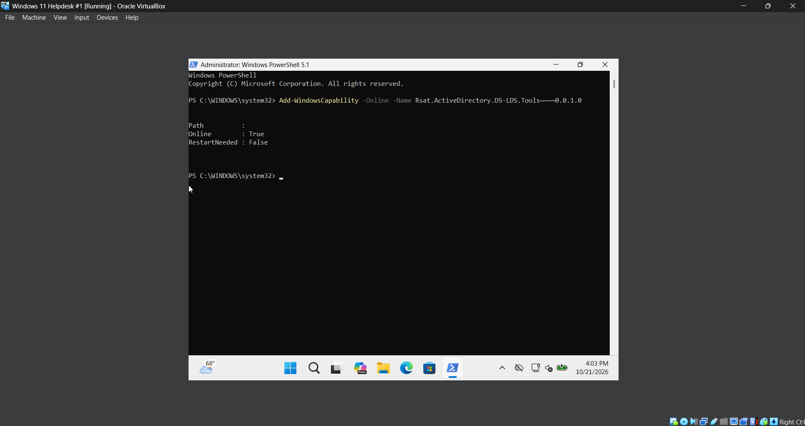

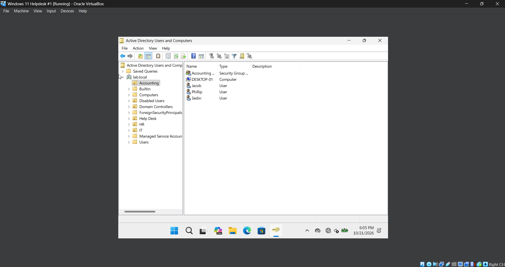

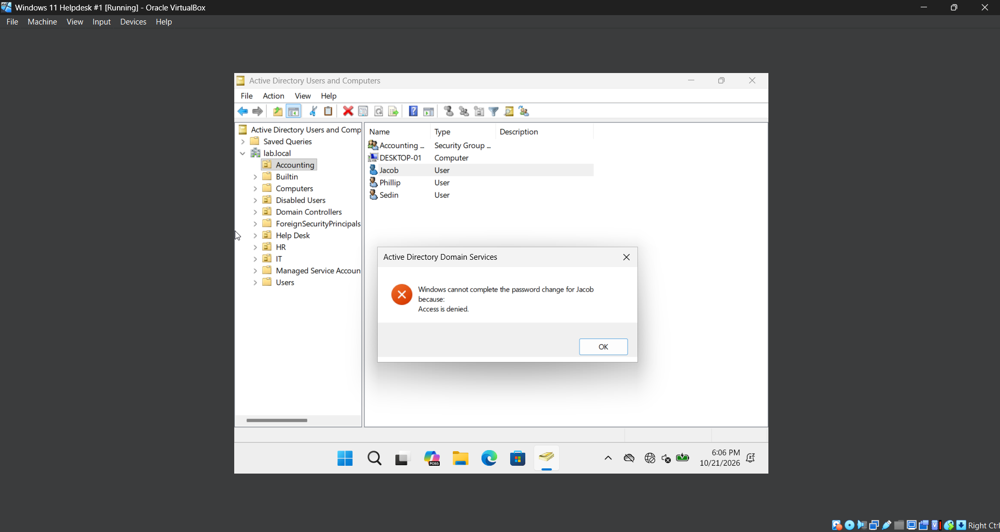

To create a dedicated workstation for Help Desk administration, I set up another **Windows 11 Pro VM** in Oracle VirtualBox named `HelpDesk-01`.

Unlike my original Windows 11 workstation from Lab 02, I no longer need to manually configure the client's IP address or DNS settings. Since I previously configured a DHCP server in Lab 09, the new workstation automatically receives its network configuration from `CA-DC-01` when connected to the correct Host-only network. I verify the network configuration, join `HelpDesk-01` to the `lab.local` domain, and restart the workstation.

During the initial Windows 11 setup, I create a local administrator account named `temp`. I use this account to prepare the workstation and install administrative tools before signing into the domain with the dedicated Help Desk account. To remotely manage Active Directory, I install **Remote Server Administration Tools (RSAT)** using an elevated Windows PowerShell session.

I first check which RSAT capabilities are available:

```powershell
Get-WindowsCapability -Online | Where-Object Name -like 'RSAT*'
```

I then install the Active Directory management tools:

```powershell
Add-WindowsCapability -Online -Name Rsat.ActiveDirectory.DS-LDS.Tools~~~~0.0.1.0
```

The installation initially fails because my isolated VirtualBox Host-only network does not provide internet access. I temporarily add a second network adapter configured for NAT to allow the VM to reach Microsoft's update services.

However, the installation continues to fail even after internet connectivity is restored. I update Windows 11 and restart the workstation before running the PowerShell installation command again. This time, the installation completes successfully.

After installing RSAT, I verify that **Active Directory Users and Computers (ADUC)** is available by launching `dsa.msc`. I then restore the workstation's original lab network configuration and sign into Windows using the standard domain account `LAB\helpdesk01`.

From the Help Desk workstation, I open ADUC and successfully connect to the `lab.local` domain. I can browse the existing Organizational Units, security groups, and user accounts without signing into the Domain Controller directly. To verify the Help Desk account's permissions before delegation, I navigate to the **Accounting** OU and attempt to reset the password for the test user **Jacob**.

The operation fails with an **Access is denied** error.

This confirms that although `helpdesk01` can access Active Directory through RSAT, the account does not currently have permission to reset the selected employee's password. This is the expected result because the Help Desk account is a standard domain user, and I have not yet delegated administrative permissions to the **Help Desk Technicians** security group. The test establishes a baseline for comparing the account's permissions before and after configuring Active Directory delegation.

### *Step 3 - Delegate and Test Help Desk Permissions*

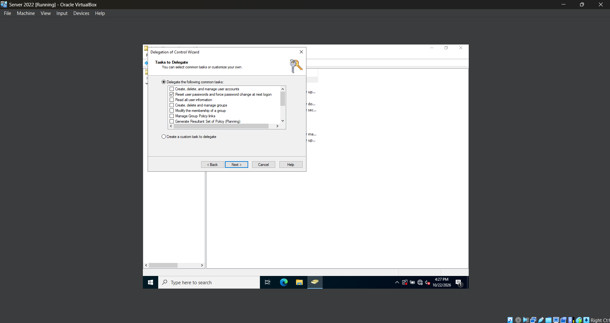

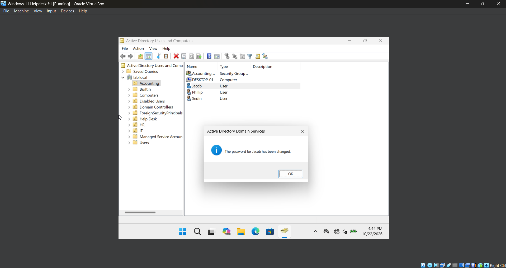

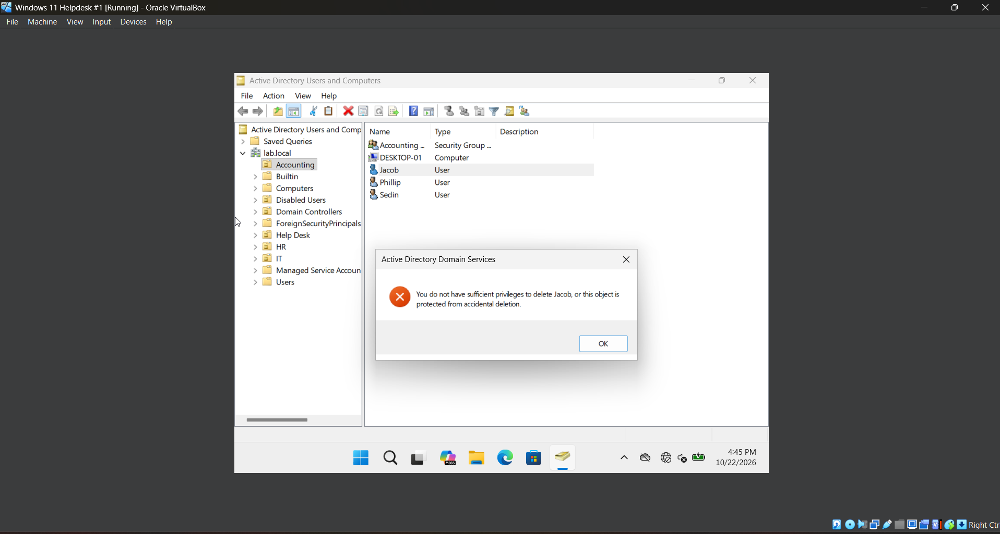

In the Windows Server 2022 VM, I open **Active Directory Users and Computers (ADUC)** and navigate to the **Accounting** Organizational Unit (OU) under the `lab.local` domain. I right-click the Accounting OU and select **Delegate Control** to open the **Delegation of Control Wizard**. I add the **Help Desk Technicians** security group, which contains the `helpdesk01` account created earlier.

Rather than assigning permissions directly to an individual user, I delegate them to the security group. This allows additional Help Desk technicians to receive the same permissions by being added to the group. In the wizard, I select **Reset user passwords and force password change at next logon**, leaving the other administrative tasks unchecked. I then complete the wizard to apply the delegated permissions.

This grants members of the Help Desk Technicians group permission to reset passwords and require password changes for applicable user accounts within the Accounting OU, without granting full administrative control over the domain. To verify the delegation, I return to the Windows 11 `HelpDesk-01` workstation and open ADUC using the standard domain account `LAB\helpdesk01`.

I navigate to the Accounting OU, right-click the test user **Jacob**, and select **Reset Password**. I enter a temporary password that meets the domain's password policy and submit the request. This time, Active Directory displays a confirmation message stating that **the password for Jacob has been changed**.

In Step 2, the same operation failed with an **Access is denied** error. After delegating the required permissions, the Help Desk account can successfully perform the password reset. To verify that the account still has limited administrative permissions, I attempt to delete Jacob's user account while signed in as `helpdesk01`.

Active Directory prevents the deletion and displays an error stating that I do not have sufficient privileges to delete the account, or that the object is protected from accidental deletion. This confirms that the deletion attempt was unsuccessful. Since I only delegated password-reset permissions, I have not intentionally granted the Help Desk Technicians group permission to delete user accounts.

These tests demonstrate the **principle of least privilege** by allowing Help Desk technicians to perform specific administrative tasks without granting broader permissions such as account deletion or full domain administration. The Help Desk account can now reset employee passwords within the Accounting OU while remaining restricted from administrative actions outside its delegated responsibilities.

### *Step 4 - Delegate and Test Account Unlock Permissions*

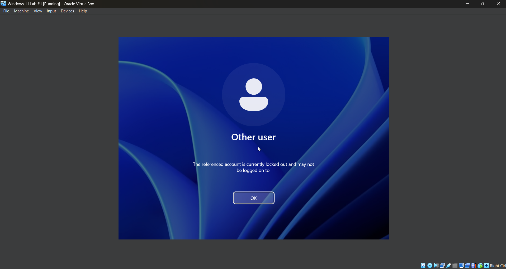

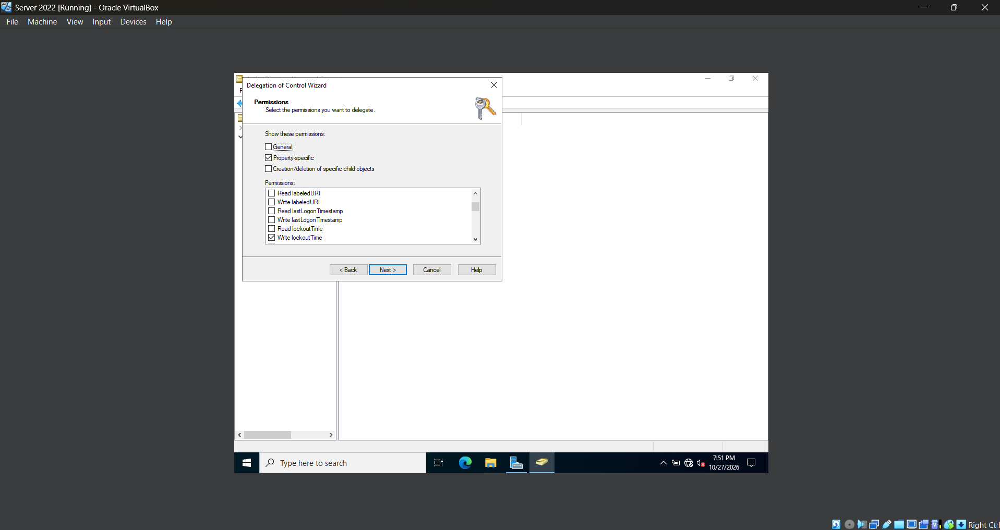

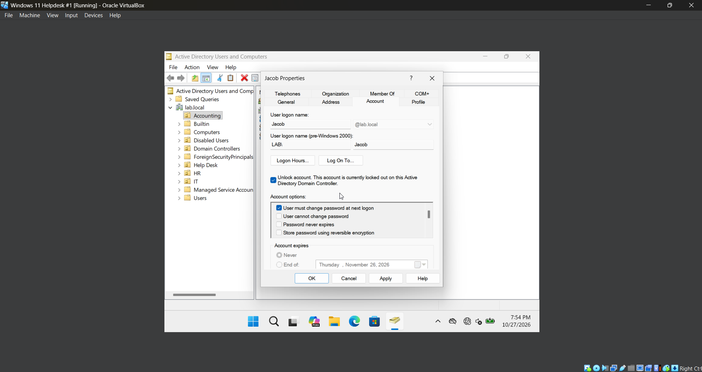

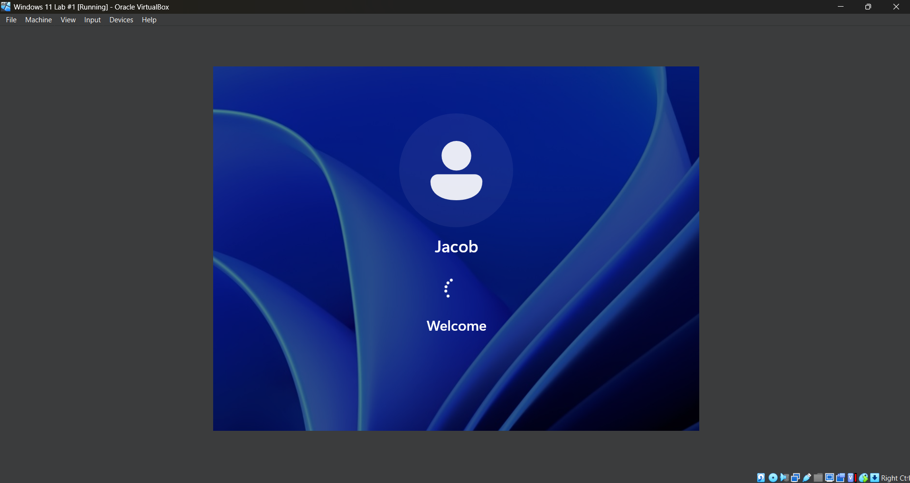

In the Windows 11 `Desktop-01` VM, I simulate an employee account lockout by attempting to sign in as **Jacob** using an incorrect password multiple times. After reaching the account lockout threshold configured in Lab 05, Windows displays a message stating that the account is currently locked out and cannot be used to sign in.

This simulates a common Help Desk situation where an employee becomes locked out of their account after entering an incorrect password too many times. I right-click the **Accounting** Organizational Unit (OU), select **Delegate Control**, and add the **Help Desk Technicians** security group. In the Delegation of Control Wizard, I select **Create a custom task to delegate** and configure the permissions to apply to user objects within the Accounting OU.

Under **Property-specific** permissions, I select **Write lockoutTime** and complete the wizard. The `lockoutTime` attribute is used by Active Directory to track account lockouts. Delegating write access to this attribute allows the Help Desk Technicians group to clear account lockouts for applicable users without granting full administrative privileges.

I then return to the Windows 11 `HelpDesk-01` workstation, signed in as `LAB\helpdesk01`, and open ADUC using RSAT. I navigate to **Accounting → Jacob → Properties → Account** and locate the **Unlock account** option. I select the checkbox and apply the change to unlock Jacob's account.

Finally, I return to the Windows 11 `Desktop-01` workstation and attempt to sign in as Jacob using the correct password. Windows proceeds to the **Welcome** screen, confirming that Jacob can authenticate again after the account unlock.

This demonstrates how Active Directory permissions can be delegated to a Help Desk security group, allowing technicians to resolve common account lockout issues without requiring Domain Administrator privileges. Combined with the password reset permissions configured in Step 3, the Help Desk account can now perform two common account recovery tasks while maintaining limited administrative access.

### *Step 5 - Verify Help Desk Administrative Restrictions*

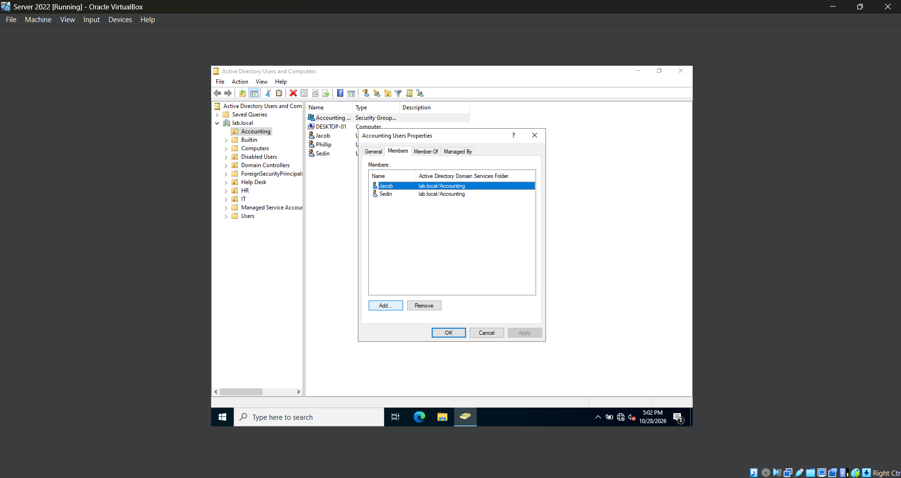

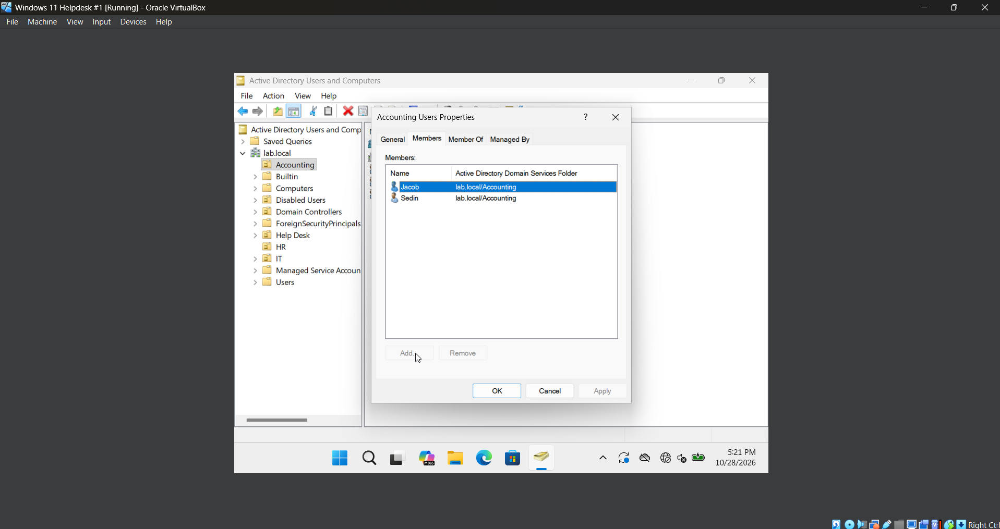

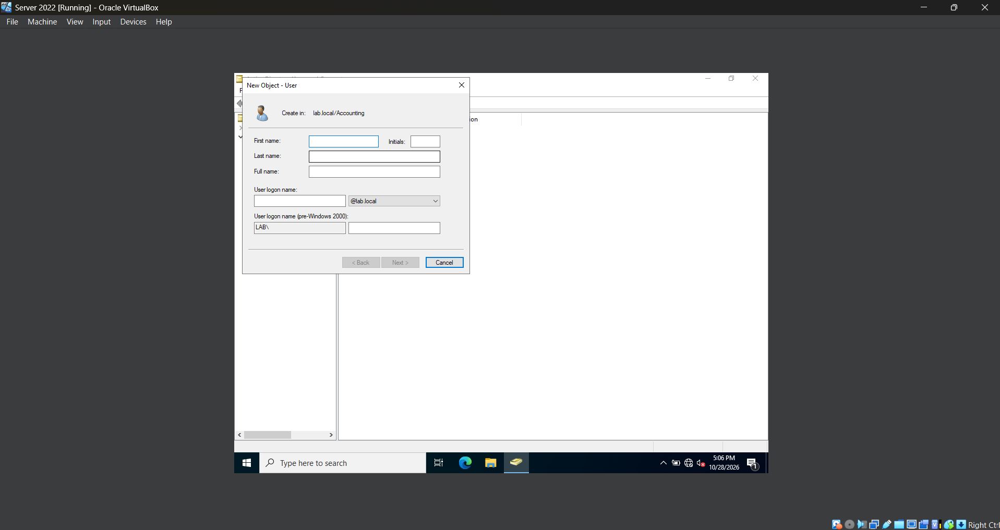

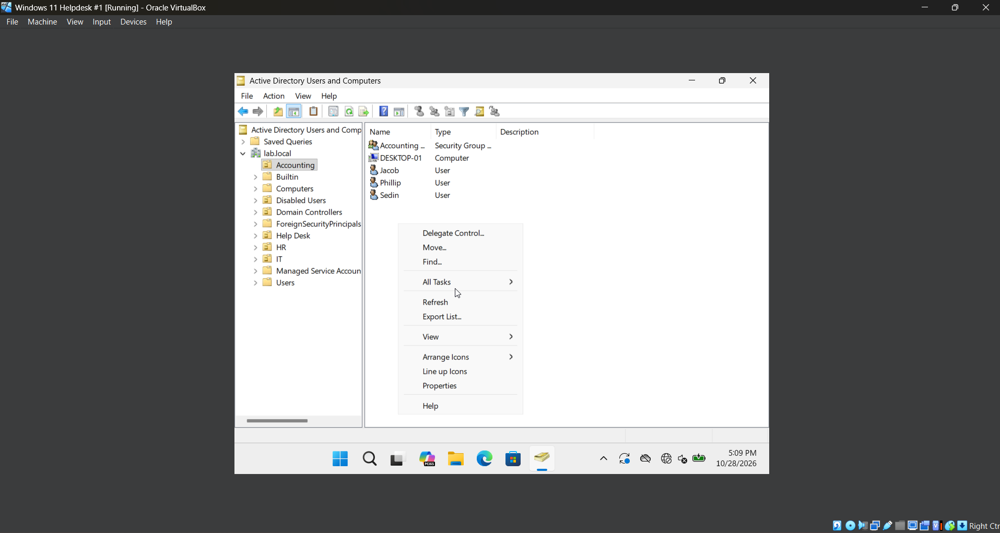

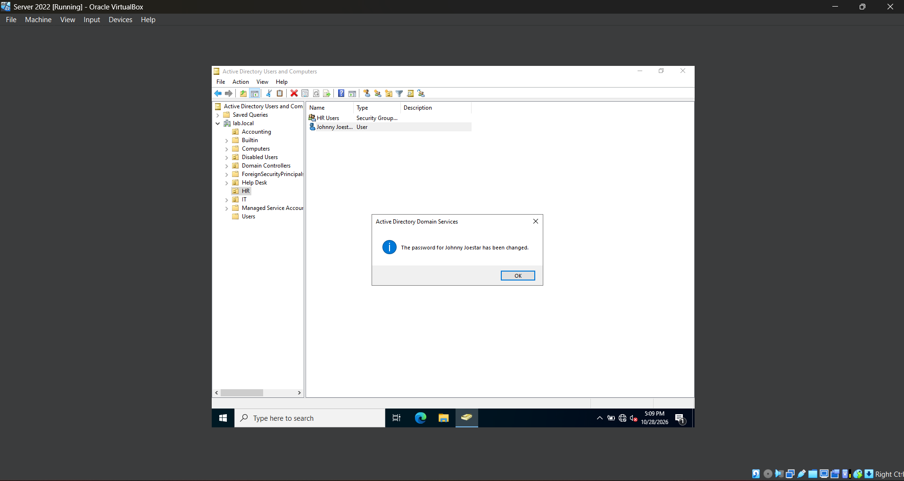

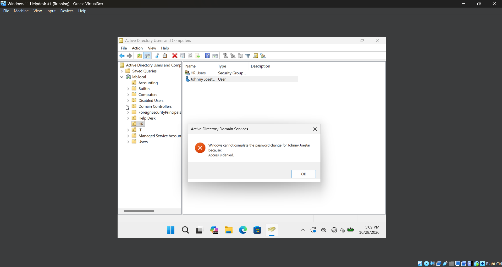

In this step, I compare the permissions of a **Domain Administrator** with those of the `helpdesk01` account to demonstrate how delegation limits what a Help Desk technician can do in Active Directory.

First, I open **Active Directory Users and Computers (ADUC)** on the Windows Server 2022 VM using the Domain Administrator account. I navigate to the **Accounting** OU and open the **Accounting Users** security group. Under the **Members** tab, I can see that the administrator has the ability to add or remove users from the group. I then switch to the Windows 11 Help Desk VM and open the same security group using the `helpdesk01` account. However, the **Add** and **Remove** buttons are disabled, preventing the Help Desk technician from modifying group membership.

Next, I compare user account creation permissions. Using the Domain Administrator account, I right-click the **Accounting** OU and select **New > User**, which opens the user creation wizard. When I attempt the same action using the Help Desk account, the option to create a new user is unavailable. Finally, I test whether the Help Desk account can reset passwords outside its delegated OU. Using the Domain Administrator account, I successfully reset the password for **Johnny Joestar**, a user located in the **HR** OU.

I then attempt to reset the same user's password using the `helpdesk01` account. Active Directory displays an **Access is denied** error, confirming that the Help Desk technician does not have permission to reset passwords within the HR OU. These tests demonstrate the **principle of least privilege**. Although the Help Desk account has permission to reset passwords and unlock accounts within the Accounting OU, it cannot create users, manage security group membership, or reset passwords in other OUs.

This allows Help Desk technicians to perform their assigned responsibilities without granting them unnecessary administrative privileges across the domain.

## **Challenges**

- When I first attempted to install RSAT on the Windows 11 Help Desk workstation, the installation failed with error `0x80240438` because my VirtualBox Host-only network did not provide internet access. I resolved the connectivity issue by temporarily adding a second network adapter configured for NAT.

- Even after restoring internet connectivity, RSAT continued to fail with error `0x800f0950`. I checked Windows Update and installed the available updates, including a newer Windows 11 version. After restarting the VM and running the PowerShell command again, RSAT installed successfully.

- After installing RSAT, I had trouble signing into the `helpdesk01` domain account because the workstation could not connect to the Domain Controller. Using `ipconfig /all`, I discovered that Windows had assigned itself an APIPA address (`169.254.x.x`) instead of receiving an address from my DHCP server. I corrected the VirtualBox network adapter configuration and restarted the VM, restoring domain connectivity.

## **What I Learned**

## **Next Steps**
