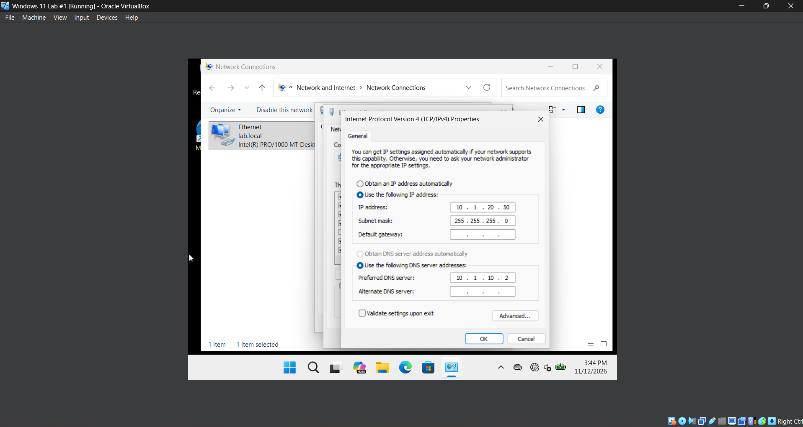
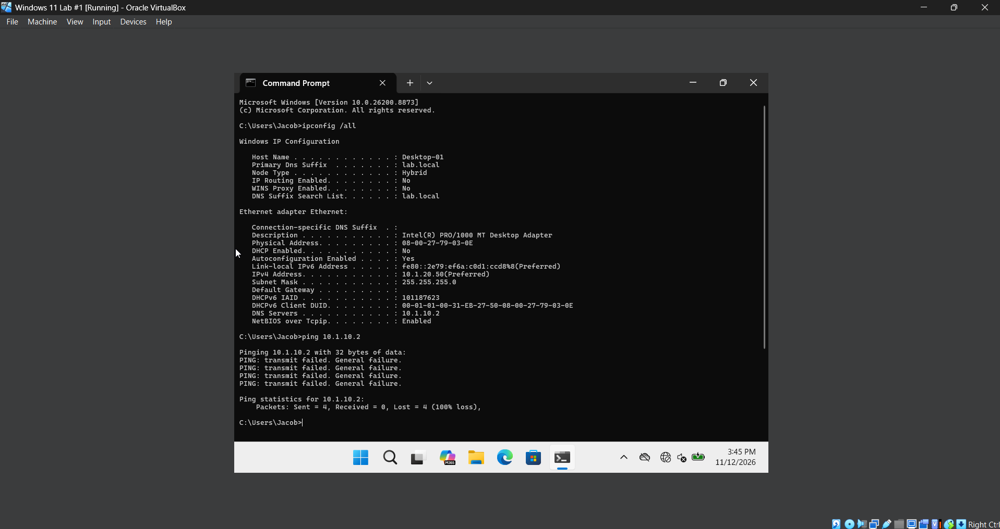

# **Lab 14 - Windows 11 Help Desk Troubleshooting**

## **Objective**

## **Environment**

## **Skills Demonstrated**

## **Steps**

### *Step 1 - Troubleshoot an Incorrect IP Configuration*

**Ticket:** An employee reports that their Windows 11 workstation cannot communicate with the company network.

In the Windows 11 `Desktop-01` VM, I begin by verifying that the workstation can communicate with the Domain Controller. I open **Command Prompt** and run `ipconfig /all` to inspect the current network configuration. The workstation has an IPv4 address of `10.1.10.12`, which was automatically assigned by the DHCP server at `10.1.10.2`. I then run `ping 10.1.10.2` and receive four successful replies with 0% packet loss, confirming that the workstation can communicate with the Domain Controller.

To simulate a network connectivity issue, I open **Network Connections** using `ncpa.cpl` and navigate to **Ethernet > Properties > Internet Protocol Version 4 (TCP/IPv4)**. I disable automatic IP address assignment and manually configure the workstation with the incorrect static IP address `10.1.20.50` and subnet mask `255.255.255.0`, leaving the default gateway blank. I keep the DNS server configured as `10.1.10.2`.

After applying the changes, I return to Command Prompt and run `ipconfig /all` to investigate the network configuration. I confirm that DHCP is disabled and the workstation is using the incorrect IP address. I then attempt to ping the Domain Controller at `10.1.10.2`, but all four attempts fail with a **General failure** message, resulting in 100% packet loss.

The issue occurs because the workstation is configured on the `10.1.20.0/24` subnet instead of the lab's `10.1.10.0/24` network. Without a default gateway, the workstation has no route to communicate with the Domain Controller on the other subnet.

To resolve the issue, I return to the IPv4 properties and restore **Obtain an IP address automatically** and **Obtain DNS server address automatically**. I then open Command Prompt and run `ipconfig /renew` to request a new IP address from the DHCP server.

Finally, I run `ipconfig /all` to verify that DHCP is enabled and the workstation has received its original IP address of `10.1.10.12`, along with the correct DNS server configuration. I test connectivity again using `ping 10.1.10.2` and receive four successful replies, confirming that communication with the Domain Controller has been restored.

This troubleshooting scenario demonstrates how an incorrect static IP configuration can prevent a workstation from communicating with network resources. By using `ipconfig` and `ping`, I was able to identify the root cause, restore DHCP-based addressing, and verify that the employee's network connectivity was functioning correctly.

## **Challenges**

## **What I Learned**

## **Next Steps**
