# **Lab 14 - Windows 11 Help Desk Troubleshooting**

## **Objective**

Practice troubleshooting common Windows 11 workstation issues that IT help desk technicians encounter, including network connectivity problems, DNS misconfigurations, shared folder access issues, Group Policy restrictions, and system performance problems.

The goal is to identify the cause of each issue, use Windows troubleshooting tools to investigate, and verify that the workstation is functioning correctly.

## **Environment**

The following software and tools were used:

- Oracle VirtualBox
- Windows Server 2022
- Windows 11
- Active Directory Domain Services (AD DS)
- DNS and DHCP
- Group Policy
- Command Prompt and PowerShell
- Task Manager
- Resource Monitor
- Event Viewer

## **Skills Demonstrated**

- Troubleshooting Windows 11 network connectivity and DNS issues.
- Using `ipconfig`, `ping`, and `nslookup` to diagnose network problems.
- Investigating shared folder access and Active Directory security group membership.
- Troubleshooting Group Policy restrictions using `gpresult`.
- Using Task Manager to identify resource-intensive processes.
- Investigating CPU usage with Resource Monitor.
- Reviewing Windows system logs with Event Viewer.
- Verifying that troubleshooting actions successfully resolve issues.

## **Steps**

### *Step 1 - Troubleshoot an Incorrect IP Configuration*

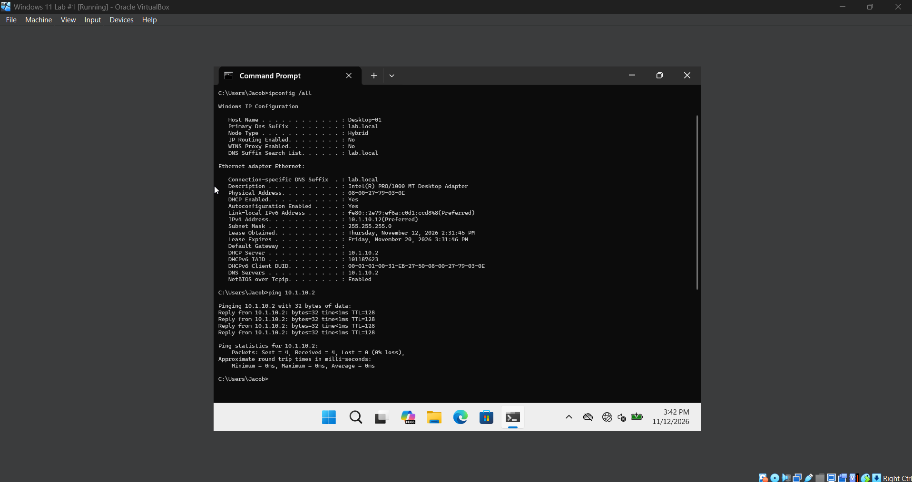


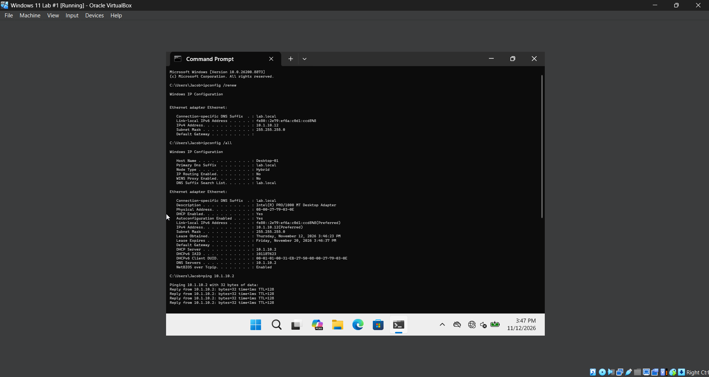

**Ticket:** An employee reports that their Windows 11 workstation cannot communicate with the company network.

In the Windows 11 `Desktop-01` VM, I begin by verifying that the workstation can communicate with the Domain Controller. I open **Command Prompt** and run `ipconfig /all` to inspect the current network configuration. The workstation has an IPv4 address of `10.1.10.12`, which was automatically assigned by the DHCP server at `10.1.10.2`. I then run `ping 10.1.10.2` and receive four successful replies with 0% packet loss, confirming that the workstation can communicate with the Domain Controller.

To simulate a network connectivity issue, I open **Network Connections** using `ncpa.cpl` and navigate to **Ethernet > Properties > Internet Protocol Version 4 (TCP/IPv4)**. I disable automatic IP address assignment and manually configure the workstation with the incorrect static IP address `10.1.20.50` and subnet mask `255.255.255.0`, leaving the default gateway blank. I keep the DNS server configured as `10.1.10.2`.

After applying the changes, I return to Command Prompt and run `ipconfig /all` to investigate the network configuration. I confirm that DHCP is disabled and the workstation is using the incorrect IP address. I then attempt to ping the Domain Controller at `10.1.10.2`, but all four attempts fail with a **General failure** message, resulting in 100% packet loss.

The issue occurs because the workstation is configured on the `10.1.20.0/24` subnet instead of the lab's `10.1.10.0/24` network. Without a default gateway, the workstation has no route to communicate with the Domain Controller on the other subnet.

To resolve the issue, I return to the IPv4 properties and restore **Obtain an IP address automatically** and **Obtain DNS server address automatically**. I then open Command Prompt and run `ipconfig /renew` to request a new IP address from the DHCP server.

Finally, I run `ipconfig /all` to verify that DHCP is enabled and the workstation has received its original IP address of `10.1.10.12`, along with the correct DNS server configuration. I test connectivity again using `ping 10.1.10.2` and receive four successful replies, confirming that communication with the Domain Controller has been restored.

This troubleshooting scenario demonstrates how an incorrect static IP configuration can prevent a workstation from communicating with network resources. By using `ipconfig` and `ping`, I was able to identify the root cause, restore DHCP-based addressing, and verify that the employee's network connectivity was functioning correctly.


### *Step 2 - Troubleshoot DNS Resolution Failure*

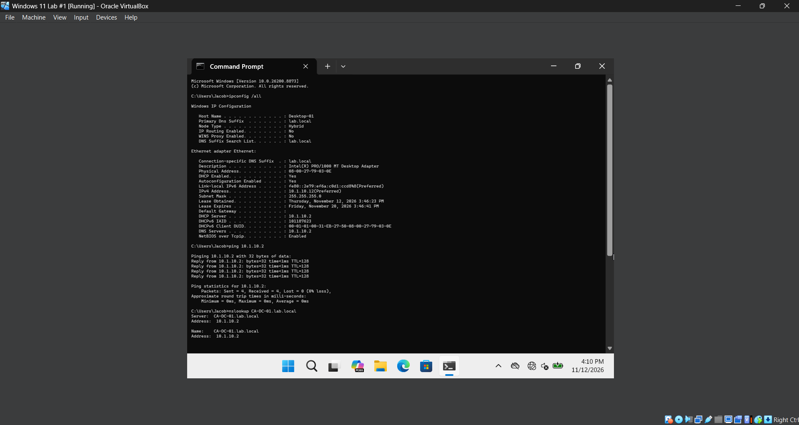


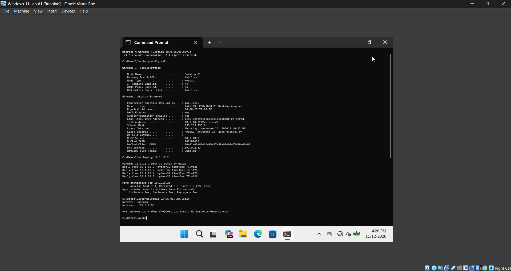

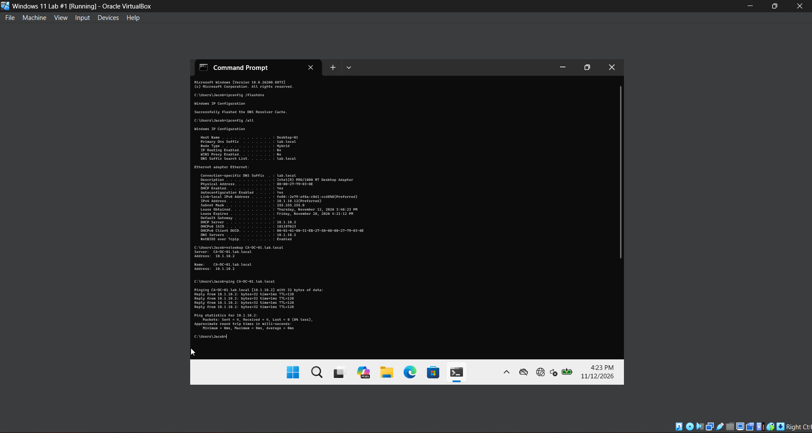

**Ticket:** An employee reports that they can communicate with the company server using its IP address but cannot access it using its hostname.

In the Windows 11 `Desktop-01` VM, I begin by verifying that the workstation can communicate with the Domain Controller and resolve its hostname. I open **Command Prompt** and run `ipconfig /all` to inspect the network configuration. The workstation has an IPv4 address of `10.1.10.12` and is using the Domain Controller at `10.1.10.2` as its DNS server. I then run `ping 10.1.10.2` and receive four successful replies with 0% packet loss. Using `nslookup CA-DC-01.lab.local`, I also confirm that the hostname successfully resolves to `10.1.10.2`.

To simulate a DNS issue, I open **Network Connections** using `ncpa.cpl` and navigate to **Ethernet > Properties > Internet Protocol Version 4 (TCP/IPv4)**. I leave automatic IP address assignment enabled but manually change the preferred DNS server to `192.0.2.53`, an intentionally incorrect DNS server address.

After applying the changes, I return to Command Prompt and run `ipconfig /all` to investigate the workstation's network configuration. The workstation still has its correct IPv4 address of `10.1.10.12`, but its DNS server is now configured as `192.0.2.53`. I then run `ping 10.1.10.2` and receive four successful replies, confirming that the workstation can still communicate with the Domain Controller using its IP address.

However, when I run `nslookup CA-DC-01.lab.local`, the lookup fails with a **No response from server** message. This confirms that the issue is related to DNS resolution rather than general network connectivity. The workstation can reach the Domain Controller by IP address, but its configured DNS server is not responding to hostname resolution requests.

To resolve the issue, I return to the IPv4 properties and select **Obtain DNS server address automatically**. I then open Command Prompt and run `ipconfig /flushdns` to clear the local DNS resolver cache. Using `ipconfig /all`, I verify that the workstation is once again using the correct DNS server at `10.1.10.2`.

Finally, I run `nslookup CA-DC-01.lab.local` and successfully resolve the Domain Controller's hostname to `10.1.10.2`. I also run `ping CA-DC-01.lab.local` and receive four successful replies with 0% packet loss, confirming that hostname resolution and network connectivity have been restored.

This troubleshooting scenario demonstrates how an incorrect DNS configuration can prevent a workstation from resolving internal network resources even when IP connectivity is functioning correctly. By using `ipconfig`, `ping`, and `nslookup`, I was able to isolate the issue, identify the root cause, restore the correct DNS settings, and verify that the employee's workstation could communicate with the Domain Controller using its hostname.


### *Step 3 - Troubleshoot Shared Folder Access Denied*

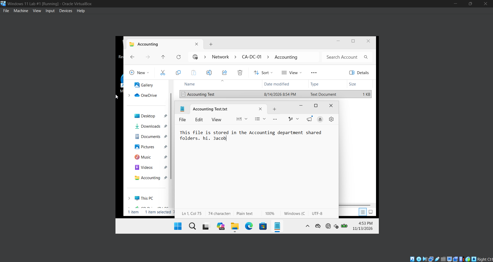

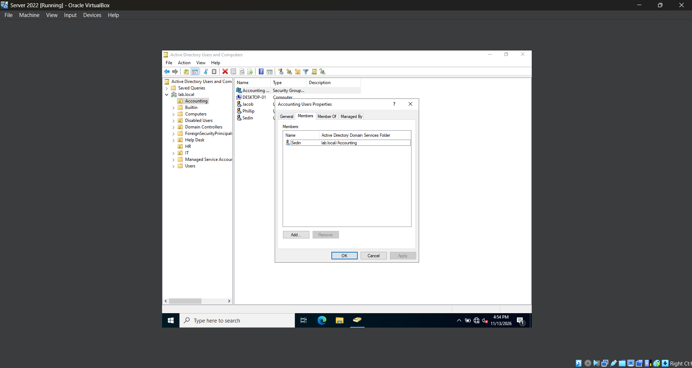

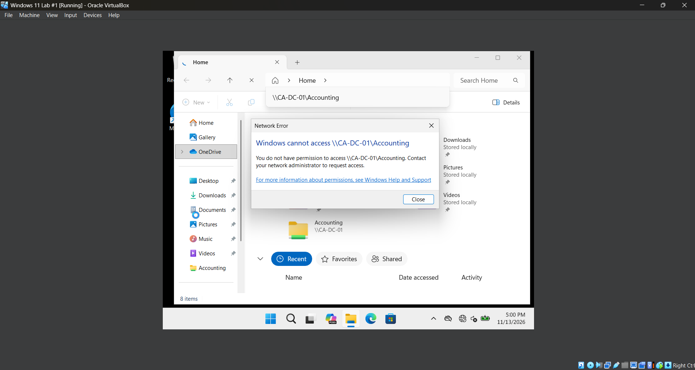

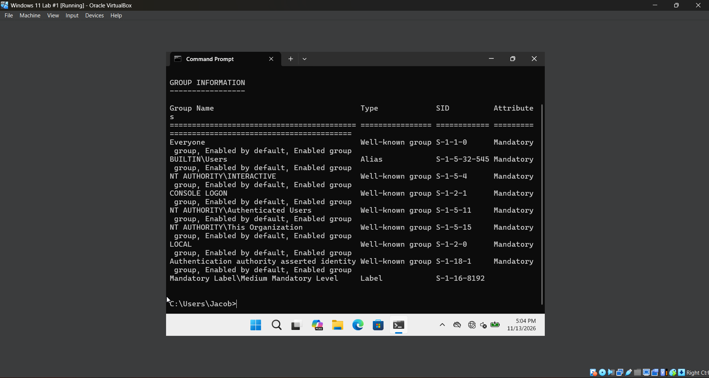

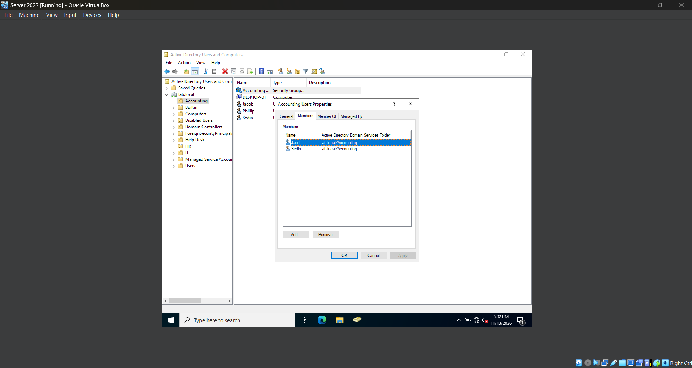

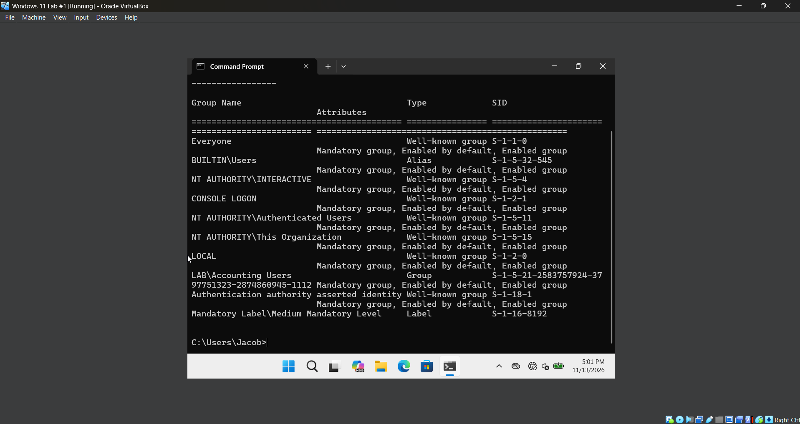

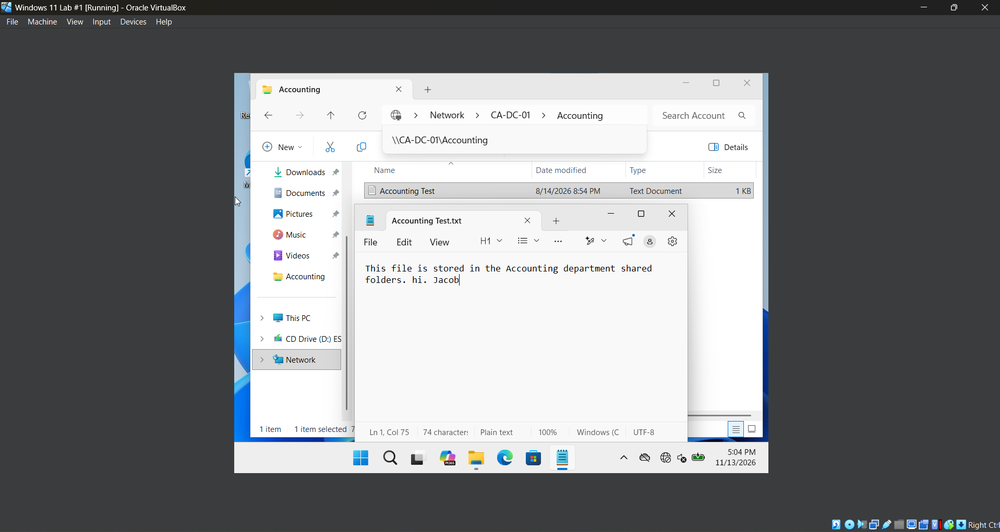

**Ticket:** An Accounting employee reports that they can no longer access their department's shared network folder, even though they previously had permission.

In the Windows 11 `Desktop-01` VM, I begin by verifying that the employee account **Jacob** can access the Accounting network share. I open **File Explorer** and navigate to `\\CA-DC-01\Accounting`, where I successfully open an existing text document and modify its contents. This confirms that the employee initially has access to the department's shared folder.

To simulate a permissions issue, I switch to the Windows Server 2022 VM and open **Active Directory Users and Computers (ADUC)** using the Domain Administrator account. I navigate to the **Accounting** OU, open the **Accounting Users** security group, and remove Jacob from its membership. This group is used to control access to the Accounting department's shared network resources.

After removing Jacob from the security group, I return to the Windows 11 workstation and attempt to access `\\CA-DC-01\Accounting` again. Windows displays a **You do not have permission to access** error, preventing the employee from opening the shared folder.

To investigate the issue, I open **Command Prompt** and run `whoami /groups` to inspect the security groups associated with Jacob's current Windows logon session. However, I notice that **Accounting Users** still appears in the output despite Jacob being removed from the group in Active Directory.

After identifying the missing Active Directory group membership as the cause of the access issue, I return to the Windows Server 2022 VM and add Jacob back to the **Accounting Users** security group. I verify that Jacob appears in the group's membership list again.

I then return to the Windows 11 workstation and run `whoami /groups` again. However, the Accounting Users group is now missing from the output, even though Jacob has been added back to the group. I attempt to resolve this by signing out and signing back into the workstation, but the group information still does not reflect the latest changes.

To troubleshoot further, I restart the Windows 11 workstation and sign back into Jacob's domain account. After restarting, the group membership information updates correctly, and I can successfully access `\\CA-DC-01\Accounting` again.

Finally, I open the existing text document inside the Accounting share to verify that the employee can access the department's files. This confirms that access to the shared folder has been restored.

This troubleshooting scenario demonstrates how Active Directory security group membership affects access to shared network resources. By investigating group membership, using `whoami /groups`, and restoring the employee's permissions, I was able to identify and resolve a shared folder access issue.

I also learned that changes to Active Directory group membership may not immediately appear in a Windows logon session, making it important to verify both the user's permissions and their current security group information when troubleshooting access-related problems.


### *Step 4 - Troubleshoot Group Policy Application*

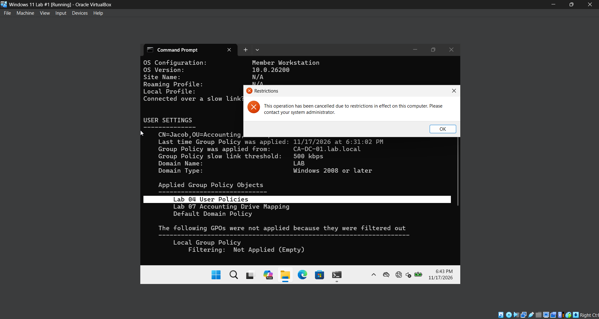

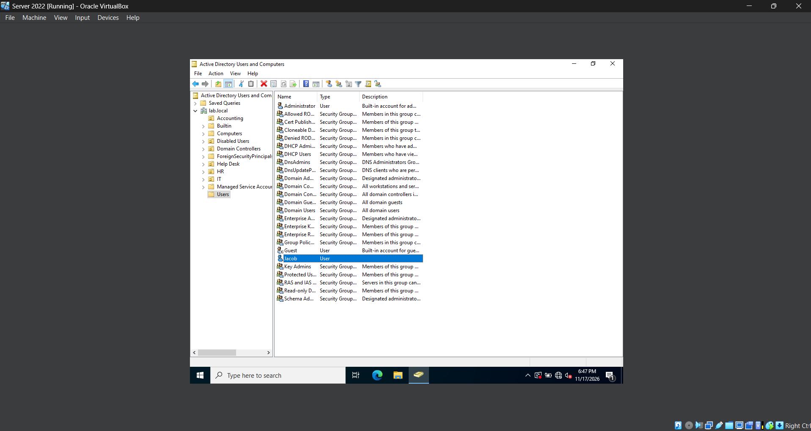

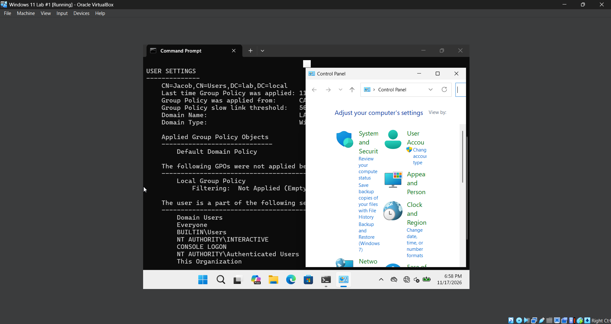

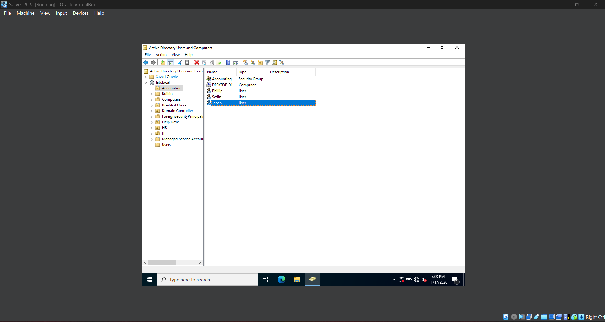

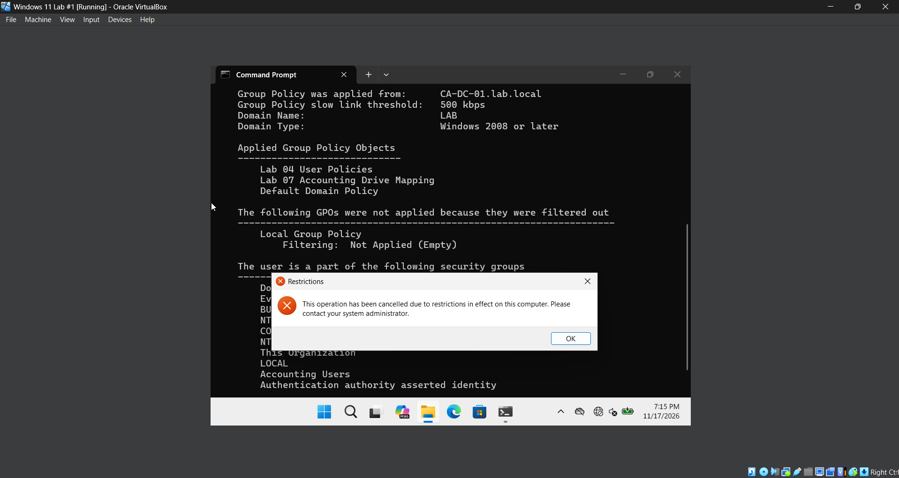

**Ticket:** An Accounting employee reports that the company's computer restrictions are no longer being applied to their workstation.

In the Windows 11 `Desktop-01` VM, I begin by verifying that the employee account **Jacob** is receiving the correct Group Policy settings. I open **Command Prompt** and run `gpresult /r` to display the Group Policy Objects (GPOs) currently applied to the user.

Under **Applied Group Policy Objects**, I confirm that **Lab 04 User Policies** and **Lab 07 Accounting Drive Mapping** are being applied. I also attempt to open **Control Panel**, but Windows displays a restriction message preventing access. This confirms that the employee is initially receiving the expected company policies.

To simulate a Group Policy issue, I switch to the Windows Server 2022 VM and open **Active Directory Users and Computers (ADUC)**. I navigate to the **Accounting** OU, right-click Jacob's account, and move it into the default **Users** container.

Because the **Lab 04 User Policies** GPO is linked to the Accounting OU, moving Jacob outside that OU removes the account from the GPO's scope.

I then return to the Windows 11 workstation, sign out of Jacob's account, and sign back in. I run `gpupdate /force` to refresh Group Policy and `gpresult /r` to check which policies are currently being applied.

This time, **Lab 04 User Policies** and **Lab 07 Accounting Drive Mapping** are missing from the applied GPO list, leaving only the **Default Domain Policy**. I also attempt to open Control Panel again, which now opens successfully without displaying the previous restriction message.

These results confirm that Jacob is no longer receiving the Accounting OU's user-based Group Policy settings.

After identifying the incorrect Organizational Unit placement as the cause of the issue, I return to the Windows Server 2022 VM and move Jacob's account from the **Users** container back into the **Accounting** OU.

I then return to the Windows 11 workstation, sign out and sign back into Jacob's account, and run `gpupdate /force` followed by `gpresult /r` to verify that the policies are being applied again.

Under **Applied Group Policy Objects**, I confirm that both **Lab 04 User Policies** and **Lab 07 Accounting Drive Mapping** have returned. I also attempt to open Control Panel again, and Windows displays the restriction message preventing access.

This confirms that the employee's Group Policy settings have been successfully restored.

This troubleshooting scenario demonstrates how Organizational Unit placement affects Group Policy application in an Active Directory environment. By using `gpresult /r`, `gpupdate /force`, and Active Directory Users and Computers, I was able to identify why the employee was no longer receiving the expected policies and restore the correct configuration.

I also learned the importance of checking a user's OU placement when troubleshooting Group Policy issues, since policies linked to a specific OU do not automatically apply to users located outside its scope.


### *Step 5 - Troubleshoot Windows 11 Performance Issues*

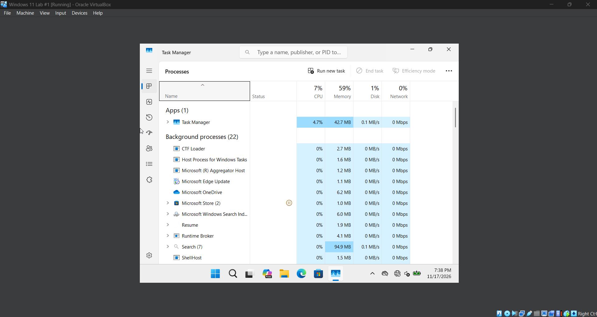

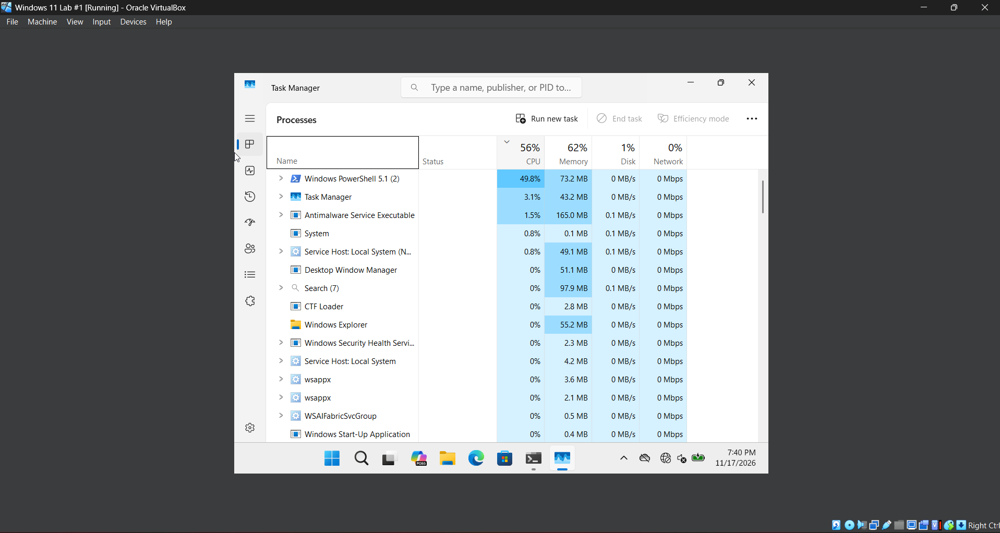

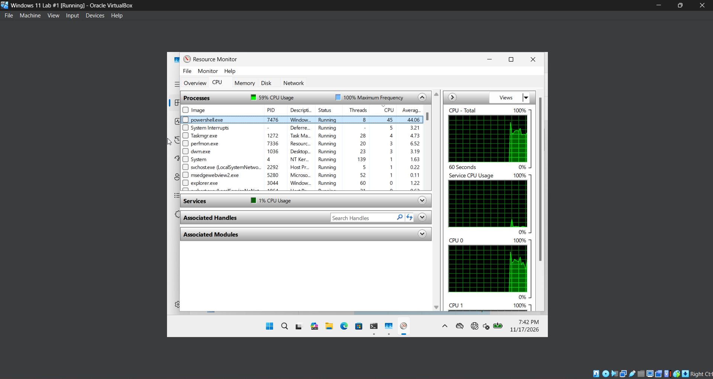

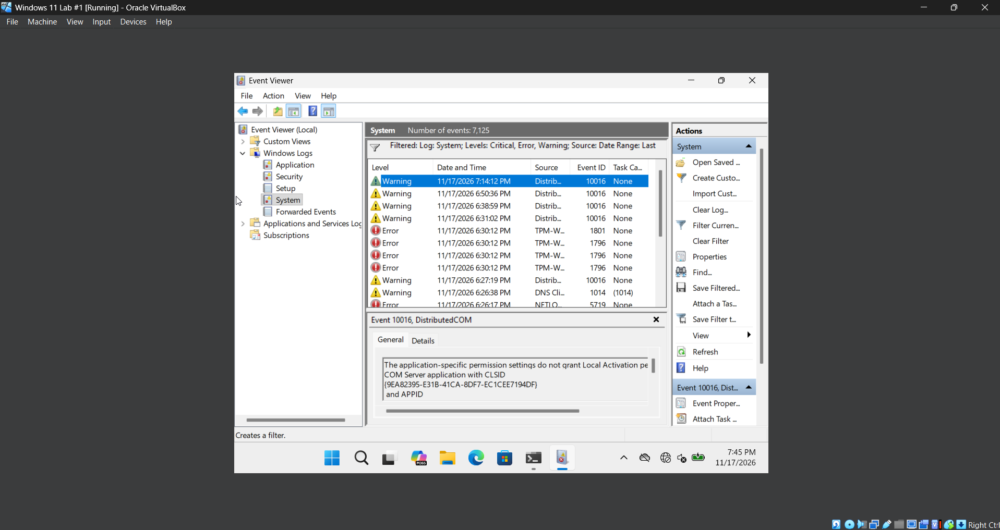

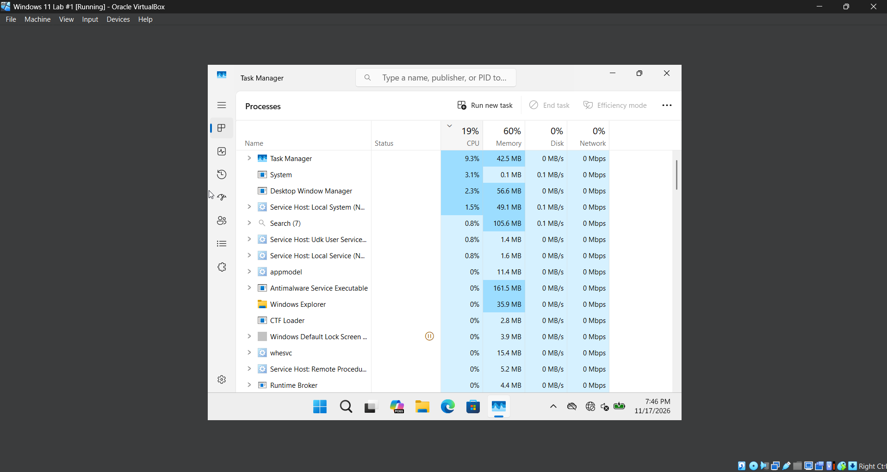

In the Windows 11 VM, I simulate a help desk ticket where an employee reports that their computer is running slowly. My goal is to identify what is consuming system resources, investigate the issue, and restore normal performance.

I first open **Task Manager** and check the workstation's CPU and memory usage. Before simulating the issue, CPU usage is approximately **7%**, while memory usage is **59%**.

Next, I open **PowerShell** and run a temporary background job that repeatedly performs calculations to simulate a resource-intensive process.

```powershell
$job = Start-Job -ScriptBlock {
    $end = (Get-Date).AddMinutes(5)
    while ((Get-Date) -lt $end) {
        [void][Math]::Sqrt((Get-Random -Minimum 1 -Maximum 1000000))
    }
}
```

After starting the workload, I return to **Task Manager** and sort the running processes by CPU usage. I notice that total CPU usage has increased to approximately **56%**, with **Windows PowerShell** consuming around **49.8%**.

To investigate further, I open **Resource Monitor** using `resmon`. Under the **CPU** section, I identify `powershell.exe` as the process consuming the most CPU resources. This confirms that the temporary PowerShell workload is responsible for the increased CPU usage.

I also open **Event Viewer** using `eventvwr.msc` and navigate to **Windows Logs > System**. I filter the logs to display **Critical**, **Error**, and **Warning** events. I review the recorded events for additional information, although the warnings shown do not establish a direct connection to the simulated performance issue.

After identifying the cause, I return to PowerShell and stop the temporary background job using the following commands:

```powershell
Stop-Job -Job $job
Remove-Job -Job $job
```

Finally, I reopen **Task Manager** to verify that CPU usage has decreased. The workstation now shows approximately **19% CPU usage**, and the PowerShell workload is no longer consuming significant resources.

This demonstrates how IT support technicians can troubleshoot performance complaints using **Task Manager**, **Resource Monitor**, and **Event Viewer** to identify resource-intensive processes, investigate potential causes, and verify that system performance has improved.

## **Challenges**

- While testing shared folder permissions, I noticed that the user could access the Accounting share when they were not a member of the **Accounting Users** group, but received an access denied error after being added to the group. I initially tried signing out and signing back in, but the issue continued. Restarting the Windows 11 VM resolved the problem, and the updated group membership was recognized correctly.
- During the Group Policy troubleshooting test, I moved the test user out of the Accounting OU to remove the restrictions. After checking the applied policies, I confirmed that the Accounting GPOs were no longer listed and that Control Panel could be opened again. I then moved the user back into the Accounting OU and verified that the restrictions were applied again.

## **What I Learned**

- How to diagnose common network and DNS configuration problems.
- How Active Directory group membership affects access to shared resources.
- Why restarting a workstation can help resolve permission and authentication issues.
- How to identify which Group Policies are applied to a user.
- How to investigate high CPU usage and identify the responsible process.
- How to use Windows troubleshooting tools to investigate and resolve workstation issues.

## **Next Steps**

- Practice troubleshooting Windows services and startup problems.
- Explore remote support and remote desktop troubleshooting.
- Investigate Windows Update failures and software installation issues.
- Continue practicing realistic IT help desk support scenarios.
